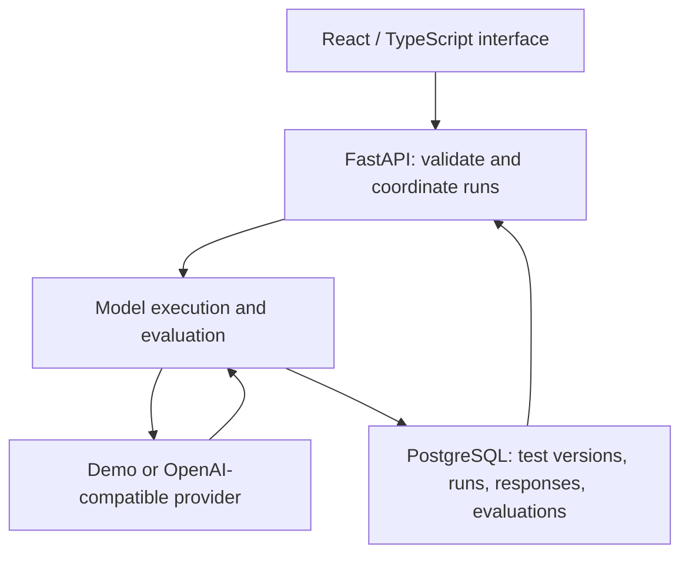

# LLM Testing & Evaluation Harness

**A Microsoft-sponsored USF capstone for comparing LLMs against the tasks people actually need them to perform.**

The harness is being developed to help individuals and teams choose a model based on task-specific output quality and cost/token usage. Users define their own prompt tests and suites, configure evaluation criteria, and compare saved evidence. The final design combines automated numerical evaluation, LLM-assisted criteria under user control, and separate human ratings.

**Stack:** Python · FastAPI · PostgreSQL · SQLAlchemy · Alembic · React · TypeScript · Docker Compose · GitHub Actions

[Try the prototype](docs/prototype-guide.md) · [Architecture](docs/architecture.md) · [Data model](docs/data-model.md) · [Requirements and roadmap](docs/requirements.md)

## Start here

This is an active four-person senior capstone at the University of South Florida, sponsored by Microsoft engineers. It is a student team project, not a Microsoft product.

The default branch retains the application foundation. The integrated database/history prototype is on **[`omar-db-history-integration-2`](https://github.com/Omar-Khalaf22/Microsoft-LLM-Testing-Harness/tree/omar-db-history-integration-2)**. Start with the [prototype guide](docs/prototype-guide.md) for the runnable workflow and exact branch instructions.

### Available prototype versus final design

| Area | Available in the integrated prototype | Final design / ongoing work |
| --- | --- | --- |
| Execution | Deterministic demo provider and an OpenAI-compatible model adapter | Broader approved model configuration and suite execution |
| Evaluation | Six configurable heuristic checks with criterion-level results | Reusable parameterized criteria, editable point allocations, and supported model-based evaluators |
| Evidence | Responses, scores, timing, usage metadata, and structured results | Consistent comparison/regression workflows and cost analysis using available usage evidence |
| Persistence | PostgreSQL schema, migrations, JSON import, saved runs, and test-version linkage | Expanded criteria, suite, and reviewer records |
| Interface | React run form, results, and saved-run history | Assisted test creation, interpretation preview, and separate human-rating workflows |
| Delivery | Local development and CI configuration | Azure deployment and operating documentation |

The prototype's heuristic score is not a factual-accuracy benchmark or an automatic recommendation of the cheapest model. The final SRS also replaces the prototype's legacy pass/fail convention with numerical scoring and separate human judgments.

## How it fits together

The integrated web/API path uses PostgreSQL. A separate lightweight browser demo uses a JSONL file so the execution/scoring flow can be explored without a database or paid model calls.

## My contributions — Omar Khalaf

- Designed and implemented the PostgreSQL schema, Alembic migrations, seed data, run persistence/retrieval, and JSON result import workflow.
- Integrated saved-run history and result retrieval into the prototype interface and API workflow.
- Authored the architecture and ER data-model documentation and led the SRS v2.0 revisions, including measurable requirements, acceptance criteria, and scoring policy.
- Designed reusable criteria definitions that bind evaluator methods, parameters, task-specific instructions, and user-selected weights; this is ongoing Prototype 2 and detailed-design work.
- Contributed to LLM/API integration and the team's DevOps workflow; cloud deployment remains part of the planned delivery.

The frontend, model adapter, evaluator, and integrated prototype were developed collaboratively by **Lina Elrafee, Ahmad Tariq, Pranjal Vashist, and Omar Khalaf**. These contribution notes describe my ownership within that team rather than claiming sole authorship of the application.

## Explore the implementation

These links point to the integrated prototype branch:

- [Execution and scoring](https://github.com/Omar-Khalaf22/Microsoft-LLM-Testing-Harness/tree/omar-db-history-integration-2/backend/app/evaluation)
- [Run/history API](https://github.com/Omar-Khalaf22/Microsoft-LLM-Testing-Harness/blob/omar-db-history-integration-2/backend/app/routes/runs.py)
- [Persistence adapter](https://github.com/Omar-Khalaf22/Microsoft-LLM-Testing-Harness/blob/omar-db-history-integration-2/backend/app/repositories/prototype_runs.py) and [SQLAlchemy models](https://github.com/Omar-Khalaf22/Microsoft-LLM-Testing-Harness/tree/omar-db-history-integration-2/backend/app/models)
- [Database migrations](https://github.com/Omar-Khalaf22/Microsoft-LLM-Testing-Harness/tree/omar-db-history-integration-2/backend/alembic/versions)
- [Run form, results, and history UI](https://github.com/Omar-Khalaf22/Microsoft-LLM-Testing-Harness/tree/omar-db-history-integration-2/frontend/src)
- [Evaluation, provider, API, and persistence tests](https://github.com/Omar-Khalaf22/Microsoft-LLM-Testing-Harness/tree/omar-db-history-integration-2/backend/tests)

See [verification instructions and implementation boundaries](docs/prototype-guide.md#verification) before interpreting prototype results.

*Project presentation reviewed October 16, 2026. Branch-specific implementation status is documented in the prototype guide.*
