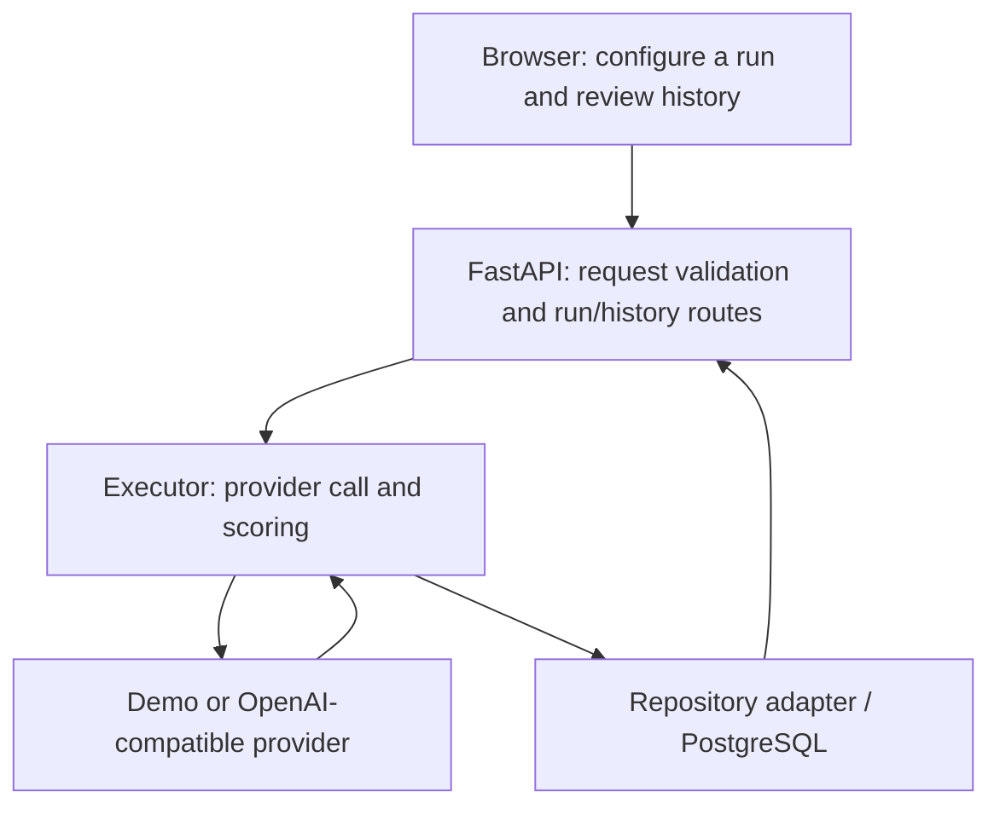
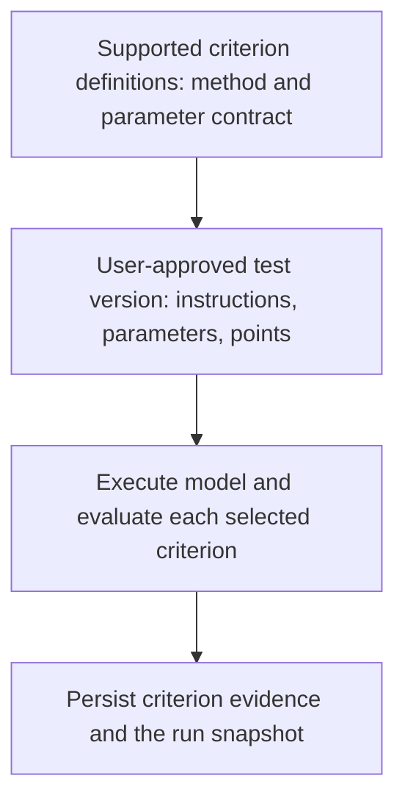

# System architecture

The harness separates test authoring, model execution, evaluation, and evidence storage so users can compare models against their own tasks. This document describes the architecture and distinguishes the integrated prototype from the SRS v2.0 final design.

## Implemented prototype structure

The [`omar-db-history-integration-2`](https://github.com/Omar-Khalaf22/Microsoft-LLM-Testing-Harness/tree/omar-db-history-integration-2) branch implements a modular application with a React/TypeScript frontend, Python/FastAPI backend, and PostgreSQL persistence.

| Boundary | Responsibility | Prototype entry point |
| --- | --- | --- |
| Frontend | Run configuration, result display, saved-run retrieval | `frontend/src/RunForm.tsx`, `RunResults.tsx`, `SavedRuns.tsx` |
| HTTP/API | Validate inputs and expose run/history operations | `backend/app/routes/runs.py` |
| Application service | Translate the API request into an execution request | `backend/app/services/run_service.py` |
| Execution | Coordinate generation, scoring, and result storage | `backend/app/evaluation/executor.py` |
| Provider adapter | Isolate demo behavior and OpenAI-compatible HTTP calls | `backend/app/evaluation/providers.py` |
| Evaluation | Apply the six prototype checks and return evidence | `backend/app/evaluation/scoring.py` |
| Persistence | Map run results into versioned relational records and history responses | `backend/app/repositories/prototype_runs.py`, `backend/app/repositories/runs.py` |

Paths above refer to the integrated branch. On `main`, application code remains the foundation snapshot. See the [prototype guide](prototype-guide.md) for setup and branch selection.

### Two demo paths

The React/FastAPI integration saves results to PostgreSQL. The separate `backend/demo.py` entry point serves a small browser interface with a JSONL repository. Both use the execution/scoring components, but the standalone demo is not a substitute for database integration testing.

## Final design: configurable evaluation

SRS v2.0 extends this foundation with supported criteria definitions, user-reviewed LLM suggestions, versioned tests/suites, a pre-run interpretation preview, comparison/regression, and human assessments.

The catalog describes executable evaluator types. A test version binds those types to task-specific inputs and weights. Reusing a definition with different bounds or instructions avoids a separate database column and scoring function for every wording of a criterion. This mapping is ongoing detailed-design/Prototype 2 work; it is not the current six-check scorer's interface.

### Scoring and assistant boundaries

- The internal assistant proposes supported criteria and point allocations. The user accepts, edits, or rejects those suggestions before a test is published.
- The model under test generates the task response. A separate interpretation preview reports the model's understanding; it is neither hidden reasoning nor a scored answer.
- Deterministic checks evaluate measurable properties. Supported model-based evaluators can produce rubric judgments; these remain evaluator judgments rather than ground truth.
- Objective criterion maxima total 100. A final total is produced only when every selected criterion has a valid result; errors leave the evaluation incomplete rather than becoming an invented zero.
- Human ratings preserve reviewer identity and notes separately from automated totals.

## Persistence and reproducibility

Test versions identify the prompt and evaluation configuration used for a run. Run records retain model/configuration, response, timing, usage when available, and evaluation evidence. History retrieves that evidence instead of silently re-running a model. See the [implemented ER model and planned extensions](data-model.md).

## Deployment and operation

Local development runs PostgreSQL through Docker Compose, with frontend and backend processes started separately. Azure hosting is a final-delivery target; no production deployment is claimed by this document. Authentication, approved endpoint controls, credential handling, retention decisions, and deployment automation belong to the remaining delivery work described in [requirements](requirements.md).

## Documentation ownership

Omar Khalaf authored the architecture and ER documentation and led the SRS v2.0 revisions. Detailed-design documentation and criteria-definition integration continue with the team.
