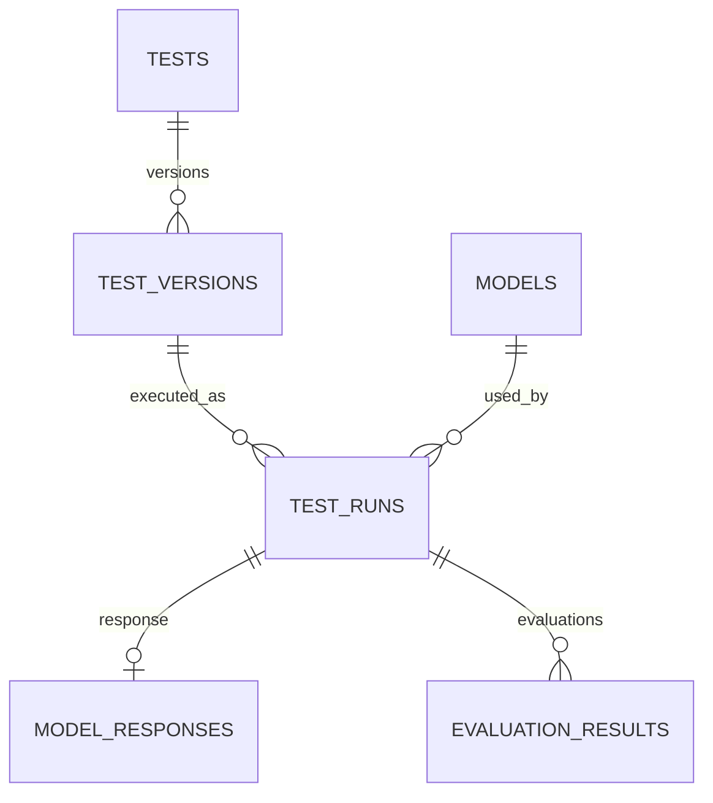

# Data model and persistence

The implemented PostgreSQL model links saved evidence to the exact test version and model used for a run. SQLAlchemy models and Alembic migrations are available on [`omar-db-history-integration-2`](https://github.com/Omar-Khalaf22/Microsoft-LLM-Testing-Harness/tree/omar-db-history-integration-2/backend/app/models).

## Implemented ER model

| Table | Stored evidence / purpose |
| --- | --- |
| `tests` | Stable test ID and display name |
| `test_versions` | Version number, version name, prompt, and JSONB evaluation definition |
| `models` | Model ID and name |
| `test_runs` | Test-version/model references, state, input prompt, JSONB configuration, latency, token counts, timestamps, and errors |
| `model_responses` | Response text, uniquely linked to one run |
| `evaluation_results` | Evaluator method, legacy pass flag, normalized score, and JSONB evaluation detail |

### Constraints and implementation choices

- A `(test_id, version)` uniqueness constraint prevents duplicate version numbers within a test.
- Foreign keys connect runs to test versions and models. Restricted deletion of referenced definitions helps preserve historical context.
- Each run has at most one stored response and may have multiple evaluation records.
- Check constraints bound stored normalized evaluation scores to `[0, 1]`, reject negative timing/token values, constrain run states, and enforce timestamp ordering.
- JSONB stores configuration and evaluator detail without requiring a new relational column for every prototype setting.

The UI's points and the persistence layer's normalized evaluation score are different representations. The repository adapters preserve the structured result and handle the database mapping; they should not be treated as interchangeable score units.

## Persistence workflow

The run API passes an execution result to `PostgresResultRepository`. The adapter resolves the test/version identity, saves the run and related evidence, and reconstructs results for the saved-run interface. Definition changes can create a new test version while repeated runs retain their existing linkage.

The integrated branch includes:

- [Schema migrations](https://github.com/Omar-Khalaf22/Microsoft-LLM-Testing-Harness/tree/omar-db-history-integration-2/backend/alembic/versions), including the Week 5 schema and test-version names.
- [Seed data](https://github.com/Omar-Khalaf22/Microsoft-LLM-Testing-Harness/blob/omar-db-history-integration-2/backend/app/seed.py).
- [Run persistence and retrieval](https://github.com/Omar-Khalaf22/Microsoft-LLM-Testing-Harness/blob/omar-db-history-integration-2/backend/app/repositories/runs.py).
- [Prototype history adapter](https://github.com/Omar-Khalaf22/Microsoft-LLM-Testing-Harness/blob/omar-db-history-integration-2/backend/app/repositories/prototype_runs.py).
- [JSON import entry point](https://github.com/Omar-Khalaf22/Microsoft-LLM-Testing-Harness/blob/omar-db-history-integration-2/backend/app/import_run.py) and [sample input](https://github.com/Omar-Khalaf22/Microsoft-LLM-Testing-Harness/blob/omar-db-history-integration-2/examples/run_result.json).

The standalone browser demo instead uses JSONL storage. See the [prototype guide](prototype-guide.md) for the distinction and setup steps.

## Criteria definitions: ongoing design

The expanded evaluation design separates three concepts:

1. **Reusable definition:** stable criterion identifier, description, evaluator method, required parameter contract, and catalog revision.
2. **Test-version selection:** the chosen definition plus task-specific instructions, parameter values, evidence expectations, and maximum points.
3. **Run result:** the selected criterion's outcome, earned points, explanation, and evaluation status for that run.

For example, a supported length evaluator can be configured with different bounds for different tests. These are parameterized instances of one method, rather than unrelated fields requiring separate columns. An LLM suggestion must resolve to a supported definition and be approved by the user before publication.

This is the intended criteria/engine/database contract. Additional catalog tables and API contracts are ongoing design/integration work and are not asserted to exist in the prototype schema above.

## Further SRS v2.0 extensions

Versioned suite membership and execution snapshots, reviewer-attributed human assessments, criterion-catalog revisions, and comparison/regression links extend the current model. Automated totals and subjective human judgments remain separate. Unknown usage must remain distinguishable from measured zero in the final evidence contract.

Omar Khalaf owns the schema, migration, persistence, and ER documentation work within the capstone team. The documented model is implemented on the integration branch; future extensions are identified explicitly here.
